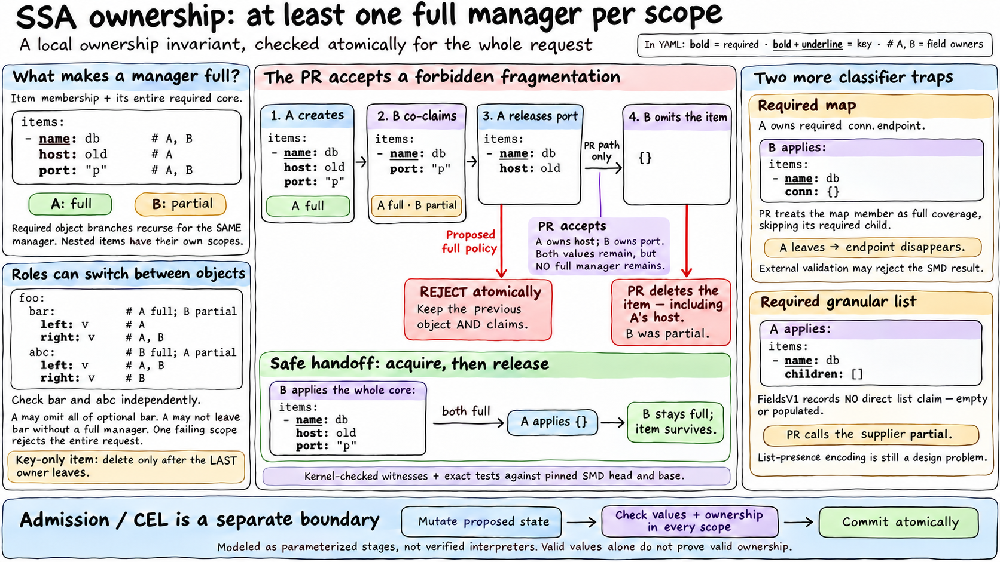

# SSA ownership reference model

This executable Lean project separates three contracts: current single-version
SSA (`current`), the required-field change in
[structured-merge-diff PR #336](https://github.com/kubernetes-sigs/structured-merge-diff/pull/336)
(`predrag`), and the stronger full-manager policy developed in that discussion
(`full`). It changes no Kubernetes request path or dependency.

The [proof explorer](docs/proofs.html) contains the accepted Lean propositions,
source, axiom dependencies and proof dependency graph. The
[property catalogue](PROPERTIES.md) maps the contracts to KEP-555 and existing
SSA tests. Human review of the definitions remains necessary.



Additional slides: [verification plumbing](docs/ssa-lean-plumbing-slide.png), [SSA core theorems](docs/ssa-core-theorems-slide.png), and [PR #336 results](docs/ssa-predrag-theorems-slide.png).

## Full-manager definition and scope

For each associative-list item, a full manager owns membership plus its entire
required core. Keys are carried by membership. A required map recursively adds
its required children to that **same manager's** core. Optional descendants do
not become part of the parent's core. Every nested item is checked independently.

Ordinary object scopes are instantiated separately, including optional maps and
the root. A required-bearing object must have one manager covering its required
core; ownership of an optional child can belong to a different manager. An
ordinary map with no required fields needs no additional completeness guard.
A key-only list item still requires a membership owner: it disappears only when
the last membership claimant leaves.

The proposed `writeScoped` operation computes item lifetimes, then optional
required-bearing object lifetimes, and validates the entire request atomically.
An actor omitting a whole scope may delete it only if that actor was full and no
full successor remains. Omitting only part of its required core is rejected if
no full manager remains. Ancestor deletion dominates descendants. The root is
never an omission-deletion root. Update is an explicit object replacement and
has separate ownership rules.

For example, if A is full in `foo.bar` and partial in `foo.abc`, while B has the
opposite roles, A may omit all of optional `foo.bar` while retaining its partial
contribution to `foo.abc`. It may not keep only half of `bar`'s required core
without a full successor. These sibling-role transitions have kernel-checked
execution proofs in `SSA/Counterexamples.lean`.

```yaml
# List keyed by name; host and port are required.
# A creates this item.
items:
- name: database
  host: db.example.com
  port: "5432"
---
# B shares only port; A remains full.
items:
- name: database
  port: "5432"
---
# A releases port: the full policy rejects this whole request.
items:
- name: database
  host: db.example.com
```

Both required values would remain, but neither manager would own the whole
core. Rejection preserves A's previous port claim. A general progress theorem
also proves that a fresh manager can acquire a normalized snapshot of unchanged
data without force, preserving the data and all existing claims. This theorem
allows sparse real ownership; it does not fabricate container claims.

Required granular lists remain a substantive design problem: current SMD
field-set extraction creates no direct claim for a known non-null granular list, even
when explicitly applied empty. The FieldsV1 trie grammar can represent such
membership; generating and preserving it through SSA operations is the missing
design. The stronger core uses an explicit collection-presence assertion for
this case. Its synthetic required-list examples do not establish compatibility
with the current implementation. The actual-wire modes preserve the missing
marker and demonstrate the PR's resulting misclassification.

Explicit null creates a direct field member. The raw PR classifier checks that
path independently of the model's value/presence tag, matching the real FieldSet
representation. Pinned list/map null controls caught and closed an earlier
model mismatch. API validity of null is checked separately; mapping nullable
required containers into the stronger policy needs additional shape metadata.

That direct claim can also survive when another manager adds children to a
previously null granular container. It is not permanently tied to null's value
tag. The comparison corpus includes populated-map/list and empty-map controls,
and a separate generated nullable-container family. Raw typed merge preserves
nonempty granular structure when null is supplied; empty/null pairs are leaves.

## Baseline counterexample

Unconditional immediate idempotence is false for current SSA: after A owns a
nonempty associative list, the first Apply of `endpoints: []` removes the field;
the second identical request creates `[]`. OpenAPI `required` or CEL
`has(self.endpoints)` rejects the first transition and every identical retry,
although empty-list creation is valid. The counterexample is kernel-checked,
connected to the imported pruning source with normalized primitives, and
reproduced through actual CRD HTTP requests and etcd. The default pipeline also
bootstraps an Update owner on a later retry. See the
[requests, cause, exact proof boundaries and checks](docs/baseline-empty-list.md).

A second baseline bug affects empty granular maps even with a presence claim:
Apply of `settings: {}` produces `settings: null`. An optional non-nullable map
then cannot be emptied; with nullable maps, another manager's identical empty
intent conflicts until the original actor repairs the value by repeating its
request. Real HTTP tests also cover CEL, atomic-map and defaulting controls.
The [bug register](docs/ssa-bugs.md) separates baseline bugs from the three
PR #336 classifier/deletion failures and links each to its proof and reproducer.

A reachable Apply/Update history additionally refutes unrestricted handoff
safety: B's Update owns a child without item membership, then A's omission
removes that item and child. A nullable list schema accepts the resulting null;
an optional non-nullable schema rejects every identical retry. The concrete
and source-bound proofs are in `SSA/HandoffCounterexamples.lean`, with actual
HTTP checks for both policies and a link to existing
[Kubernetes #134902](https://github.com/kubernetes/kubernetes/issues/134902).

A subresource counterexample concerns valid CRDs with an additional root such
as `settings`: `/status` can claim unchanged `settings.desired`, despite the
REST strategy restoring every non-status value. The original main manager's
next change then conflicts. `ResetCounterexamples` refutes this broader reset
contract; the HTTP test checks exact leaf claims and unchanged storage after
rejection. Conventional spec/status reset controls pass. The complete imported
Apply body explains installation through the configured filter, whose roots
omit settings; primitive and REST-envelope refinement remain explicit.

A numeric counterexample refutes unrestricted scalar-intent and non-forced
foreign-value safety. A owns exact int64 `9223372036854775807`; B asserts
binary64 `2^63`, without force. Alone, the assertion is discarded as a false
no-op while B acquires its claim. Adding unrelated `note: changed` makes the
different numeric value persist while both managers retain the claim. Real
HTTP/GET confirms both results; an exact int64 change correctly conflicts.
`NumericCounterexamples` proves these concrete imported-Apply executions and
the contract refutations under explicit scalar primitives. It also proves
nontransitive numeric equality and the impossibility of a faithful ordinary
equality quotient. See [SSA-05](docs/ssa-bugs.md#ssa-05-rounded-numeric-comparison-loses-intent-or-misses-a-conflict).

A second numeric failure is in FieldsV1 key decoding: exact integer selector
`id: 9007199254740993` becomes its neighbor `9007199254740992`. A valid CRD
then rejects B adding that distinct neighbor item with a conflict against A.
`NumericCodecCounterexamples` refutes exact numeric path round-tripping for a
canonical starting trie under the concrete numeric-read specification. Complete
Go byte/key round trips reproduce the witness in vendored and both pinned SMD
revisions, and HTTP verifies the false conflict and atomic rollback. The
structural FieldsV1 theorem remains true after label decoding. See
[SSA-06](docs/ssa-bugs.md#ssa-06-fieldsv1-rounding-aliases-distinct-integer-list-keys).

## What is checked

- General core laws: scalar conflicts, equal-value co-ownership, force transfer,
  exclusive/shared omission, exact actor claims, intent preservation, immediate
  accepted-Apply idempotence, finite-history validity, and co-ownership monotonicity.
- General structural laws: every proper ancestor is a real container; a scalar
  cannot have descendants; composite key names have a canonical strict order.
- General locality: full classification depends only on claims below that item,
  with recursive required-map coverage at arbitrary finite depth.
- General progress: unchanged snapshot acquisition by a fresh manager succeeds.
- Update: complete data replacement, touched-field ownership, preservation of
  untouched claims, distinct Apply/Update manager identities, and invariant preservation for arbitrary finite mixed scoped histories.
- Boundary composition: mutation before final validation, relational old/new
  validators, final item/object checks, atomic rollback, and the inability of value-only validation to
  distinguish different ownership of the same data. Arbitrary validators may
  block a handoff; no unconditional availability claim is made.
- Exact finite counterexamples for PR #336: ownership fragmentation followed by
  partial deletion, required-map member shortcut, and required granular lists.
- Baseline counterexample: empty-list Apply changes data on repetition; a
  presence validator makes every finite number of identical retries fail.
- Default Apply wrapper: Update-from-empty initialization preserves data,
  leaves existing manager maps alone and creates non-Apply claims. A concrete
  proof and real wrapper comparison track reinitialization after ownership loss.
- General PR compatibility: with no additional required metadata, `predrag` and
  `current` transitions are equal for every finite state and normalized request.

`SSA/Apply.lean` and its `Contracts` proofs describe the proposed item-core
transition. `ObjectScope` adds the per-object policy; the core's exact idempotence
proof is not advertised as a theorem about arbitrary admission or the whole
scoped operation. `Pruning` and `Semantics` represent the current/PR field-set
algorithm separately, including named-field expansion, three-pass pruning,
implicit key leaves, empty/null promotion and the final ownership update.

`WireContracts` proves laws for that separate current/PR transition: pruning
retains foreign claims until the final comparison, the candidate is independent
of force, final foreign claims have an exact survival condition, successful
non-forced requests do not modify foreign-owned final targets, and forcing an
already successful request preserves its result. Fresh unchanged snapshot
acquisition is also proved directly for both raw modes; it requires only
structural validity, not the proposed full-manager invariant.

The accepted-result laws additionally prove that a changed foreign final target
conflicts without force; force admits a structurally valid candidate; changed
foreign claims disappear; and unchanged final targets retain co-ownership.
These statements concern the raw model, not just the proposed stronger core.
The Go primitive and updater refinement obligations remain open in the catalogue.

## Binding proofs to source

`cmd/ssa-source` uses Go's parser to import complete bodies and checked signatures
from the selected updater and element-set sources into `SSA/GoSource.lean` and
`SSA/ElementSource.lean`:

| Source function | Kernel-checked contract |
| --- | --- |
| `addBackDanglingItems` | `SourceContracts.imported_dangling_matches_spec` |
| `addBackOwnedItemsForVersion` | `SourceContracts.imported_owned_version_matches_spec` |
| `addBackOwnedItems` | `OwnedSource.imported_owned_items_matches_spec` |
| `prune` | `PruneSource.imported_prune_matches_spec` |
| `Apply` | `ApplySource.imported_apply_matches_spec` |
| `PathElementSet.Difference`, `Union`, `Intersection` (`fieldpath/element.go`) | `ElementAlgebra.imported_matches`, `imported_membership`, `imported_preserves_order`, `imported_preserves_uniqueness` |

The interpreter handles lexical variable identity, tuple assignment, error
zero values, short-circuit nil checks, map presence, local version maps and
finite map traversal. It quantifies over every lawful version-map iteration
permutation. Statement fuel bounds syntax depth; the loop proofs cover arbitrary
finite manager/version counts. Unsupported syntax, map aliases, mutations of
iterated maps, unbound globals and changed import bindings are rejected.
Successful conversion has a non-nil result in the primitive contract; a failed
conversion retains its optional returned object rather than assuming it is nil.

The complete Apply contract covers reconciliation, merge and extraction errors,
legacy/current filter selection, snapshotting the old actor set before installing
the filtered set, prune/update ordering and nil-object returns on a data no-op.
Both configured filter maps, missing version entries and nil maps are distinct.
A missing legacy exclusion set is an execution failure, matching its nil-set
dereference; it is not invented as an ordinary returned API error. Successful
callbacks have non-nil objects and allocated logical managed maps. Their
primitive behavior and unmodeled aliasing side effects remain review obligations.

`ResetFields` proves prefix exclusion, filter idempotence and recursive trie
membership refinement at arbitrary finite depth. The source-level theorem
`ApplySource.imported_apply_excludes_reset_fields` composes this filter with an
explicit non-growth contract for the remaining final updater callback. The Go
filter and updater implementations still need refinement; the theorem does not
assume the desired conclusion about the whole Apply result.

`PruningRefinement.single_version_pruning_refinement` connects all four imported
functions to the normalized three-pass model for arbitrary states and field
sets, with all managers in one API version. Its callee-realization witnesses
discharge the restoration callbacks using the other imported source functions.
The model's phase factoring has a separate exact equality with its original
formula. Each imported function has a semantic Go-source mutation that must
invalidate the unchanged theorem at the expected module.

The Go parser/importer and subset semantics need human review. Conversion,
typed field-set extraction, named-field expansion, set primitives and removal
remain explicit primitive contracts. Their Go implementations and the remaining
updater/request pipeline are further proof obligations. The multi-version
source orchestration contract does not establish semantic correctness of API
conversions. No generated AST digest substitutes for those proofs.

`ElementAlgebra` proves the three element-set operations from their complete
Go bodies with one shared loop induction. The typed interpreter checks fresh
output allocation, short-circuit bounds, safe slice/index access, append and
increments. All operations have a linear fuel bound for arbitrary finite inputs
and comparators. Union preserves Go's choice of the right representative on an
equal-key branch; this control-flow theorem needs no equality assumption.

Exact difference/union/intersection membership and sorted, duplicate-free outputs
then follow under the stated sorted-input and strict-total-order premises.
`ElementOrder.nat_strict_order` constructs those laws for the rank comparator
used by the executable comparison. The existing `ElementDifference` theorem
names remain specializations, including the stronger difference-only order
preservation law that needs neither comparator laws nor a sorted right input.
These are general proofs rather than fixture enumeration.

An independent comparison executes all three real Go methods and the imported
interpreter on all 4,096 subset pairs of six independently ranked elements per
operation: 12,288 operation/pair cases in total. The elements span field, key,
value and index selectors. Boolean membership oracles independently constrain
the results; input size and membership are checked after every Go call. Each
method has a semantic source mutation that its shared proof must reject.
This bounded evidence supports the interpreter/representation boundary, not a
universal proof of Go's PathElement comparator. The comparator, `Has`/binary
search, recursive Set/SetNodeMap operations and complete filter composition
remain explicit obligations. These component theorems do not prove the full
field-path operations used by pruning.

The mixed numeric comparator actually fails the global equality/order premise:
two distinct int64 values can each compare equal to one float64. A concrete
numeric-key Difference retains an element that the excluded set's `Has` finds.
`--numeric-counterexamples` executes the imported source witnesses; the Go
comparison checks their observations against real equality, element sets and
managedfields. General IEEE conversion and typed primitives are not thereby
verified; the witness model represents finite nonnegative integral floats only.

`RawSourceCounterexamples` instantiates this complete pruning chain for both
empty-list transitions, with all callees realized under every lawful map
schedule. The actual typed/set implementations are still separate from those
normalized primitive instances.

`FieldsV1` independently proves the recursive trie/object-grammar round trip at
arbitrary finite depth, including leaf `{}` membership and the `"."` marker
used when membership and descendants coexist. Its canonicality premise excludes
empty child sets and duplicate edge keys. JSON bytes and path-element string
parsing remain separate obligations; this does not verify Go's JSON library.
The unrestricted numeric-key codec obligation is now refuted: the concrete
reader changes a canonical selector's magnitude. The comparison inspects exact
decoded key values and bytes, rather than trusting the same mixed-number
`Has`/`Equals` relation that masks this loss.
`FieldPathSet` additionally proves exact trie-to-path-set membership at arbitrary
depth and the correspondence of normalized difference/intersection with trie
selection. Empty structural nodes in selection still require wire normalization.

## Implementation evidence

The Go adapter independently walks a supplied SMD structural schema. It supports
named/recursive types, granular and atomic maps/lists, unknown map entries,
composite scalar list-map keys, scalar sets, JSON scalars including null, and
sparse empty-map ownership. Structural context does not invent claims. Values,
container presence ownership, item ownership and errors are compared after each
request; only the API envelope, redundant key leaves, and associative-list order
are projected out.

The independent [baseline corpus](testdata/bridge.yaml), deterministic scalar
and structural Apply/Update sequences run against the actual managedfields
wrappers with real FieldsV1 round trips. New mismatches fail with a replayable
request prefix. There is no tolerated `model-gap` category. Intended differences
between the stronger policy and existing Go require exact independent outcomes
for both engines.

Corpus, path and schema-default decoding preserve int64 tokens before falling
back to float64, matching the API's numeric domain. Regression checks retain
integers above `2^53`, including MaxInt64, in both requests and independent
expectations. Previously the adapter rounded untyped numbers to float64 before
either engine could observe them; that comparison defect is fixed rather than
used to exclude the numeric counterexample.

The adapter keeps operation distinct from the literal manager name. Plain names
retain readable labels such as `A` and `A@update`; names containing reserved
characters are quoted with their operation. Thus an Apply manager literally
named `A@update` is `apply("A@update")`, separate from an Update by `A`.
Independent cases check acquisition, omission and co-ownership across these
identities. The comparison still fixes one API version and excludes subresources.

Explicit `bootstrap: true` cases additionally run the actual
`NewSkipNonAppliedManager` wrapper and the separate `Bootstrap` model.
This comparison accepts single-version Apply-only histories and also runs
generated structural requests. Probabilistic non-Apply tracking is outside
that comparison domain; unsupported combinations fail explicitly.

[PR cases](testdata/pr336.yaml) also run against **both pinned upstream revisions**:
head `6fab440a518a1b329e5cabd5a3c924d6c267828b` and base
`560aaa513ea735bf59e6011feecd5388e2dfeae9`. The runner uses the actual v7 updater,
original required metadata at the head, unchanged metadata-free schema at the
base, operation flags and field-set serialization. It neither patches upstream
logic nor modifies Kubernetes' module graph. Both revisions' merge tests run.

## Proof boundary

The quantifiers cover arbitrary finite normalized states, paths, manager sets,
required cores and request histories in the stated contract. The instance-expanded
schema is built for the keys/scopes used by a trace; an arbitrary future key
universe is not pre-enumerated in a theorem about a particular schema.

The Go comparisons are bounded evidence, **not a proof that every Go execution
refines Lean**. API-version conversion, changing schema topology, defaulting,
list-key defaults, deduced/unstructured union types, duplicate-list semantics,
subresource/reset filters and storage retries are not fully modeled. Duplicate
keys and set entries are rejected by this adapter. Numeric values follow the
Go JSON decoding domain; no arbitrary-precision JSON number theorem is claimed.

Admission/CEL behavior is represented by functions with explicit predicates,
not by verified interpreters or a formalization of every Kubernetes admission
plugin. The proposed guard rejects already-fragmented initial states; rollout,
repair and migration need a separate policy. These boundaries are distinct from
the two former representation defects, which are now fixed and checked.

## Verification

No Mathlib or external Lake packages are used. Install the pinned Lean release
from `lean-toolchain`, then run:

```sh
bash ci/verify.sh
lake exe ssa-model --list
lake exe ssa-model --trace raw-pr-fragmentation-and-partial-deletion
```

`ci/verify.sh` can install Lean with a checked-in SHA-256. Go and Python 3 are
required; Go may download the toolchain required by the pinned v7 upstream
source. Set `SSA_LAKE` for an existing Lean installation. Full logs are retained.

Verification cleans/rebuilds, audits every declaration and project module,
rechecks proof terms with `leanchecker --fresh Main`, rejects five negative
audit probes, checks/regenerates fixture JSON, runs Go tests and both upstream
comparisons, and rejects a stale HTML explorer. No check is skipped. Prow setup
in [ci](ci/README.md) requires a separate test-infra activation.

In a Kubernetes checkout, `bash ci/verify-apiserver.sh` additionally runs the
actual HTTP/etcd empty-container counterexamples, Required/CEL rejection,
ownership bootstrap, Update-owned list-item omission and status reset ownership.
It also checks all three numeric variants, with exact native numeric types,
retained claims and persisted GET observations.
The numeric-key test additionally checks a false conflict between distinct
large integer list keys and successful independent small-key management.
The proposed Kubernetes Prow job runs both entrypoints. The API check belongs
to Kubernetes integration testing and is unavailable in published apimachinery.

Regenerate the fixtures and explorer after model changes:

```sh
lake build
lake exe ssa-model --fixtures > fixtures/scenarios.json
lake env lean SSA/Audit.lean
python3 docs/generate.py
```

The HTML is standalone and requires no network or server. Statements, source
snapshots and direct dependency edges come from Lean's accepted environment;
explanations and specification choices remain reviewable human content.
